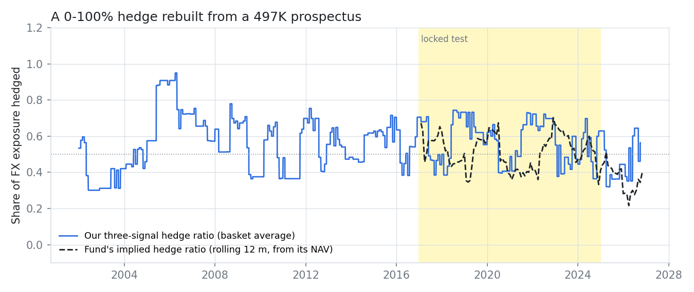
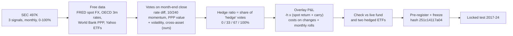
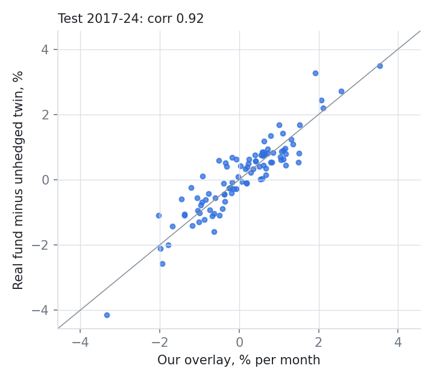
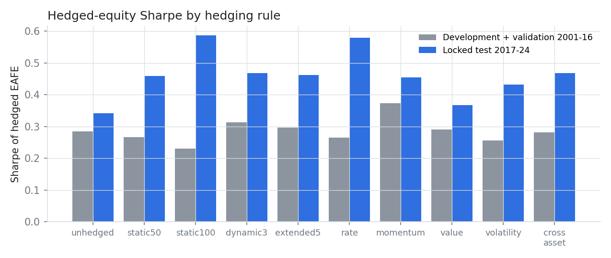
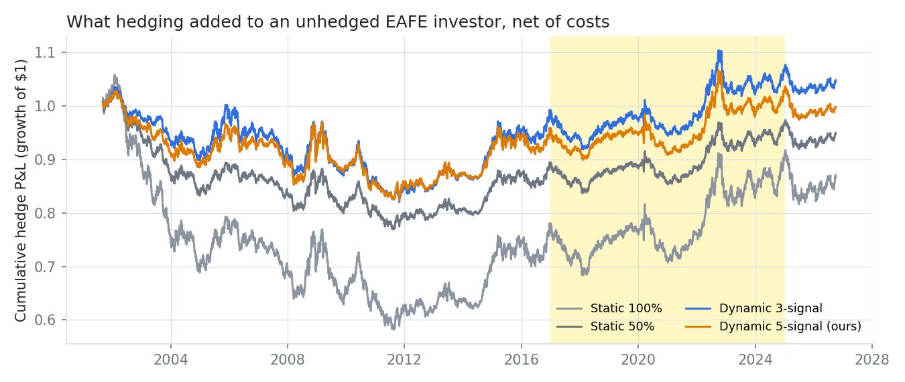

# Hedge or Not?

### Can a currency-hedging rule be rebuilt from three sentences of an ETF prospectus, and does it beat a simple static hedge?


> **TL;DR.** A dynamic-currency-hedged equity ETF discloses in its summary prospectus that it sets a 0-100% hedge
> ratio every month from three equally weighted signals: interest-rate differentials, 10/240-day momentum and PPP
> value. We rebuilt the rule from that text alone with free FRED, OECD and World Bank data. **It tracks the live
> fund's hedge effect at a 0.92 monthly correlation (1.6% tracking error).** In a locked 2017-24 test it beat staying
> unhedged (+0.13 Sharpe, one-sided p = 0.048; 6.6 pp smaller drawdown), but it did **not** beat a plain 50% hedge
> (+0.01), and our two extra signals added nothing.



---

## 1. The research: what the prospectus says

Source: Form 497K summary prospectus of a dynamic-currency-hedged international equity ETF (January 2016). Verbatim:

> *"The Index determines and adjusts the hedge ratios on such foreign currencies on a monthly basis using three
> equally-weighted, quantitative signals: interest rate differentials, momentum, and value."*
>
> *"Momentum ... comparing two moving average signals on the historically observed U.S. dollar spot rates over 10 and
> 240 business day periods. Value ... the foreign currency spot rate over 20 business days as compared to the latest
> purchasing power parity (PPP) numbers as published by the ... OECD."*
>
> *"This approach is designed to limit losses related to foreign currencies as such currencies depreciate against the
> U.S. dollar while participating in gains ... when such currencies appreciate."*

All seven quotes and what we take from each: [`research/institutional_methodology.md`](research/institutional_methodology.md).

## 2. The gap

| What is missing | Why it matters |
|---|---|
| **An open test of the disclosed rule.** The index provider's methodology document is not free, and published evidence is mostly marketing. | "Best of both worlds" is a testable claim: does the rule beat a static hedge? |
| **Proof that a disclosure is enough to rebuild a product.** | If three sentences reproduce a live fund, the rule is the product; if not, the disclosure hides the important part. |
| **Academic hedging theory is static.** Optimal-hedge papers (Campbell, Serfaty-de Medeiros & Viceira 2010) give fixed ratios, not monthly signal rules. | A dynamic rule must beat the static benchmark investors would otherwise use. |
| **Do more signals help?** Volatility and cross-asset signals are common add-ons in practice. | Every extra signal costs turnover. |

## 3. Our solution



| Design choice | What we did |
|---|---|
| Nine currencies | EUR, JPY, GBP, CHF, AUD, SEK, DKK, NOK, NZD at MSCI EAFE weights (95% of the basket) |
| Carry | OECD 3-month interbank differentials stand in for 1-month forward points (covered interest parity), lagged one month |
| PPP | World Bank PPP (OECD-Eurostat figures), lagged two years; the euro uses a GDP-weighted five-country composite |
| Timing | Votes on the last business day of month m; ratio applied for all of month m+1 (unit-tested) |
| Equity leg | EFA, the unhedged USD MSCI EAFE ETF, total return |

## 4. Results (locked test 2017-24, 96 months, net of 4-10 bp/yr hedging costs)

**The reconstruction is faithful.**

| Our overlay vs a real fund's hedge effect (monthly) | Correlation | Tracking error |
|---|---|---|
| Our 100% hedge vs iShares hedged EAFE minus EFA | 0.990 | 1.0%/yr |
| Our 100% hedge vs Xtrackers hedged EAFE minus EFA | 0.989 | 1.1%/yr |
| **Our 3-signal rule vs the dynamic fund minus its unhedged twin** | **0.919** | **1.6%/yr** |
| Time-varying part only (both minus a 50% hedge; post hoc) | 0.55 | - |

The fund's implied average hedge ratio was 53%; ours was 57%.

|  |  |
|---|---|

**But the signals did not add value over a static hedge.**

| | Pre-registered claim | Result | Verdict |
|---|---|---|---|
| **H1** | Dynamic 3-signal beats static 50% | Sharpe +0.008 [-0.04, 0.05], p = 0.36 | Not supported |
| **H2** | Volatility + cross-asset signals help | -0.005, p = 0.60 | Not supported |
| **H3** | Any disclosed signal alone beats static 50% (Holm) | best: rate +1.1%/yr, p_holm = 0.40 | Not supported |
| secondary | Dynamic 3-signal vs unhedged | +0.13 Sharpe [-0.01, 0.28], one-sided p = 0.048 | Better than unhedged |

| Rule (test) | Return/yr | Vol | Sharpe | Max DD | Avg hedge |
|---|---|---|---|---|---|
| Unhedged | 5.4% | 15.8% | 0.34 | -28.4% | 0% |
| Static 50% | 6.3% | 13.8% | 0.46 | -22.0% | 50% |
| Static 100% | 7.3% | 12.4% | 0.59 | -20.8% | 100% |
| **Dynamic 3-signal** | 6.3% | 13.5% | 0.47 | -21.8% | 57% |



The real ETFs agree with the model: over the same 96 months the dynamic fund's Sharpe was 0.44 against 0.28 for its
unhedged twin, and the fully hedged EAFE ETF beat both (0.63).

## 5. What we learned

1. **A three-sentence disclosure is enough to rebuild a live product.** That is a useful finding about disclosure in
   itself.
2. **The dynamic rule lands on the static 50% line.** Its real benefit is risk reduction versus unhedged (2.3 pp
   less volatility, 6.6 pp smaller drawdown), not alpha.
3. **2017-24 rewarded hedging everything.** US rates were above every foreign rate, so hedging earned carry while the
   dollar rose; no rule can beat the best static hedge in a one-regime sample. In 2025-26, when the dollar fell,
   unhedged won.
4. **More signals, more cost, no gain.** Our volatility and cross-asset votes did not help.

## 6. How we kept it honest

Pre-registration frozen (hash `251c14117a04`) before 2017+ data could load; every run logged in
[`research/experiment_log.md`](research/experiment_log.md); a look-ahead test checks that hedge ratios never change
when later data change; the replication check on the time-varying part was added after the test and is labelled
post hoc.

## 7. Reproduce

```bash
pip install -e ./qcore -e .
python scripts/run.py download                     # FRED, World Bank, Yahoo (free)
python scripts/run.py dev
PREREG_HASH=251c14117a04 python scripts/run.py test
PREREG_HASH=251c14117a04 python scripts/figures.py
pytest
```

## 8. Repository map

```
configs/         hedge.yaml (basket, signals, costs), splits.yaml
src/fxhedge/     data.py (FRED, World Bank, Yahoo), macro.py (spot, rates, carry), model.py (votes, ratios, overlay)
scripts/         run.py (dev / test, replication, regret, hypothesis tests), figures.py
research/        institutional_methodology, preregistration, experiment_log, results, limitations, sources/
results/         figures/, tables/ (summaries, replication, regret)
qcore/           period splits with the test lock, metrics, stationary bootstrap
tests/           look-ahead and hedge-ratio tests
```

**Limitations** ([full list](research/limitations.md)): interbank rates proxy forward points; PPP is today's vintage;
EFA stands in for the fund's dividend-weighted index; vote rules are our reading of the prospectus; one carry regime.

**References:** Campbell, Serfaty-de Medeiros & Viceira (2010) *Global Currency Hedging*, JF · Menkhoff, Sarno, Schmeling
& Schrimpf (2012) *Currency Momentum Strategies*, JFE · Lustig, Roussanov & Verdelhan (2011) *Common Risk Factors in
Currency Markets*, RFS · Politis & Romano (1994).

*Research artifact, not investment advice.*
